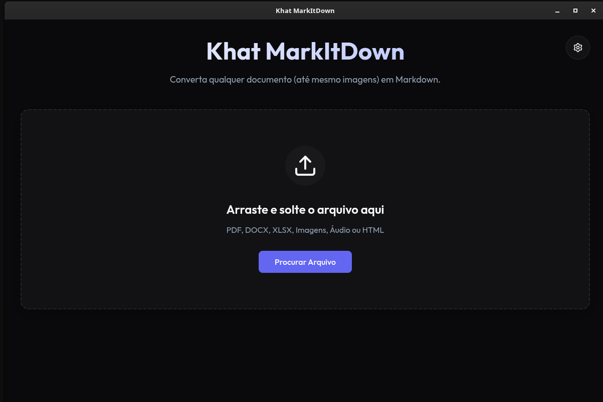
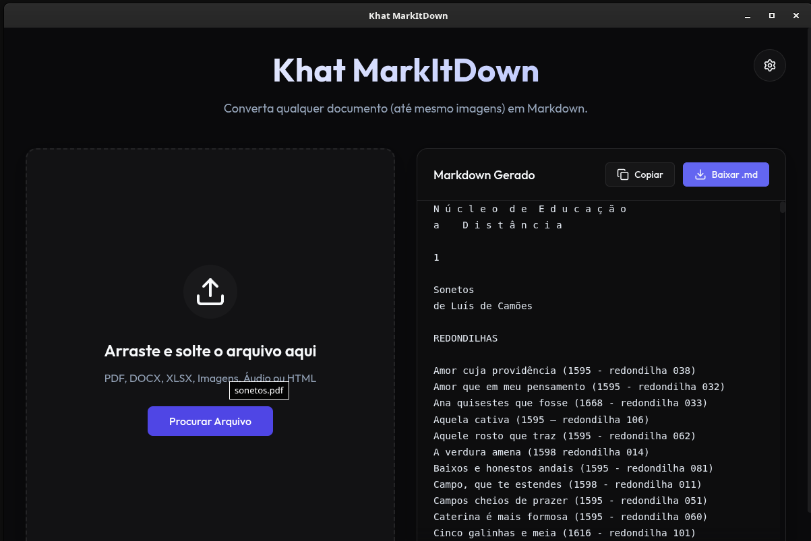

# Khat Mark And Json

<p align="center">
  
  
</p>

> "A principal palavra egípcia antiga para o corpo físico que abriga o espírito é **Khat** (também grafado como Kha). Este termo refere-se especificamente ao corpo material e mortal, sujeito à decomposição, que servia como receptáculo ou 'navio' terreno para as partes imortais da alma (como o Ba e o Ka). É por causa da importância do Khat como âncora para o espírito que os antigos egípcios desenvolveram rituais complexos de mumificação para preservá-lo."

Inspirado nessa mitologia, o **Khat Mark And Json** nasceu com um propósito exato: fornecer um "corpo" visual e acessível. 

Enquanto a robusta biblioteca original [MarkItDown da Microsoft](https://github.com/microsoft/markitdown) atua nos bastidores como o poderoso "espírito" do projeto — operando de forma invisível através de linhas de código e terminais de comando — este projeto é o seu **receptáculo terreno**. 

O **Khat** constrói uma interface gráfica (*GUI*) moderna que materializa esse motor em algo tátil e amigável. Ele abriga a incrível força de conversão para Markdown limpo e extração de dados estruturados em JSON dentro de um "corpo" visual elegante, permitindo que o imenso poder da ferramenta ganhe forma, se torne duradouro e seja operado por qualquer pessoa sem necessidade de conhecimento em programação.

## Recursos
- **Saída Dupla (Markdown e JSON)**: Escolha entre converter seus documentos para um formato de leitura limpo (Markdown) ou extrair todos os dados em um formato puramente estruturado (JSON), pronto para bancos de dados e APIs.
- **Multi-plataforma**: Construído com Electron, rodando nativamente no Windows, macOS e Linux (.deb, .rpm, .AppImage, flatpak).
- **Design Premium**: Interface baseada em *Glassmorphism* limpa e intuitiva construída com React e Vite.
- **Backend Autônomo**: Processamento via FastAPI no Python, empacotado internamente (Sidecar) via PyInstaller.
- **Suporte a LLM (Inteligência Artificial)**: Basta inserir sua chave de API nas configurações para liberar leitura de imagens e diagramas avançados.
- **Suporte Estendido de Arquivos**: Além dos formatos suportados nativamente pelo motor original (PDF, DOCX, XLSX, PPTX, HTML, CSV, Áudio e Imagens), o **Khat estende a biblioteca da Microsoft**, adicionando interceptadores exclusivos para dar suporte inédito a arquivos do LibreOffice/OpenDocument (`.ods` e `.odt`).

## Estrutura do Projeto
- `/backend`: API Python e script de compilação do sidecar (`build.sh`).
- `/frontend`: Aplicação Vite + React e orquestrador Electron (`main.cjs`).

## Como Rodar Localmente (Desenvolvimento)

### Pré-requisitos
- Node.js
- Python 3.10+

### Setup Rápido
1. Ative o ambiente Python no backend e instale as dependências:
   ```bash
   cd backend
   python -m venv venv
   source venv/bin/activate  # ou venv\Scripts\activate no Windows
   pip install "markitdown[all]" fastapi uvicorn python-multipart pyinstaller openai pandas odfpy openpyxl
   ```
2. Inicie o Electron no modo Dev:
   ```bash
   cd frontend
   npm install
   npm run electron:dev
   ```

## Compilando para Produção (Build)
Para gerar os instaladores e binários nativos de distribuição:
1. Compile o backend em um único executável:
   ```bash
   cd backend && ./build.sh
   ```
2. Empacote com o `electron-builder`:
   ```bash
   cd frontend && npm run electron:build
   ```
Os arquivos finais de instalação estarão dentro de `frontend/release/`.

## Automação por agentes de IA (CLI e servidor MCP)

O mesmo binário do backend (`markitdown-backend`; em desenvolvimento, `python backend/main.py`) funciona como CLI e como servidor MCP quando recebe argumentos. **Sem argumentos**, sobe o servidor HTTP usado pela interface gráfica. Tudo é 100% offline e headless: não abre janelas, não usa rede nem LLM.

### CLI

```bash
markitdown-backend convert ARQUIVO [--formato md|json] [--saida CAMINHO] [--sobrescrever] [--max-chars N] [--dry-run] [--json]
markitdown-backend describe        # (ou --schema) lista comandos, ferramentas MCP e códigos de saída, em JSON
```

- Sem `--saida`, o conteúdo vai para o stdout. Markdown acima de `--max-chars` (padrão 200000) é truncado, com aviso no stderr; JSON acima desse limite exige `--saida`.
- `--saida` recusa sobrescrever um arquivo existente, salvo com `--sobrescrever`.
- `--dry-run` valida tudo (caminhos, extensão, tamanho, confinamento) sem converter nem gravar.
- Com `--json`, a saída e os erros são JSON: `{"erro": "...", "codigo": "..."}`.
- Extensões aceitas: `.pdf .docx .pptx .xlsx .xls .csv .ods .odt .html .htm .xml .json .txt .md .epub .msg` (`.zip` fica de fora por segurança). Limite de entrada: 50 MB (`--max-input-mb`).

**Códigos de saída:** `0` sucesso · `1` erro de negócio (campo `codigo`: `ENTRADA_INVALIDA`, `ARQUIVO_NAO_ENCONTRADO`, `EXTENSAO_NAO_SUPORTADA`, `ARQUIVO_GRANDE`, `CAMINHO_RECUSADO`, `SAIDA_EXISTE`, `CONTEUDO_GRANDE`, `CONVERSAO_FALHOU`, `ERRO_DE_ESCRITA`) · `2` uso incorreto ou argumento inválido.

### Servidor MCP (stdio, JSON-RPC 2.0)

```bash
markitdown-backend mcp [--automation-read-root DIR] [--automation-write-root DIR] [--max-input-mb N]
```

Métodos: `initialize` (negocia `2025-06-18`, `2025-03-26` e `2024-11-05`), `ping`, `tools/list` e `tools/call`. Ferramentas:

- `inspecionar`: versões, extensões, modo, confinamento e limites (somente leitura).
- `executar`: `{arquivo, formato?, saida?, max_chars?, sobrescrever?, dry_run?}`, com a mesma semântica da CLI.

Erros de domínio voltam como resultado com `isError: true`; JSON inválido e método inexistente são erros de protocolo (`-32700`, `-32601`). O stdout carrega só o protocolo; qualquer ruído de bibliotecas e subprocessos é desviado para o stderr.

**Confinamento (fail-closed):** sem nenhuma raiz, não há confinamento. Com qualquer raiz, cada direção precisa da sua: ler exige `--automation-read-root` e gravar exige `--automation-write-root`. Uma flag `--automation-*` desconhecida, sem valor, ou qualquer argumento solto aborta com código `2`. O modo ponte `--connect` não é suportado (somente headless) e também retorna `2`.

Registro num cliente MCP (o app **não** faz isso por você):

```json
{ "mcpServers": { "khat-mark-and-json": {
  "command": "/caminho/para/markitdown-backend",
  "args": ["mcp", "--automation-read-root", "/caminho/dos/documentos", "--automation-write-root", "/caminho/das/saidas"]
} } }
```

## Licença e Créditos
Este projeto utiliza e funciona como uma interface gráfica para a biblioteca de código aberto `markitdown` criada pela Microsoft, distribuída sob a Licença MIT. 
Todo o código original de interface (GUI) e infraestrutura presente neste repositório também pode ser utilizado sob a Licença MIT.

---

## ☕ Apoie o Projeto (Doações)
Este projeto é desenvolvido e mantido de forma totalmente independente e de código aberto. Se o **Khat Mark And Json** economizou seu tempo e otimizou seu fluxo de trabalho, considere apoiar o desenvolvimento contínuo fazendo uma doação via **Pix**!

**Chave Pix (Aleatória):**
`0d323a66-4090-4e03-aa6d-889abfac5ee7`

Qualquer valor é imensamente agradecido e ajuda a manter ferramentas livres e gratuitas vivas! ❤️
